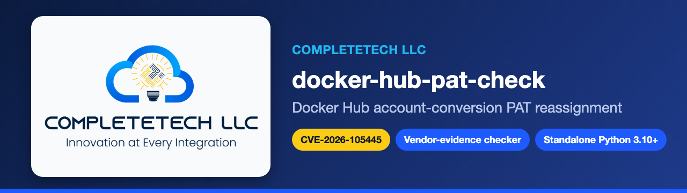
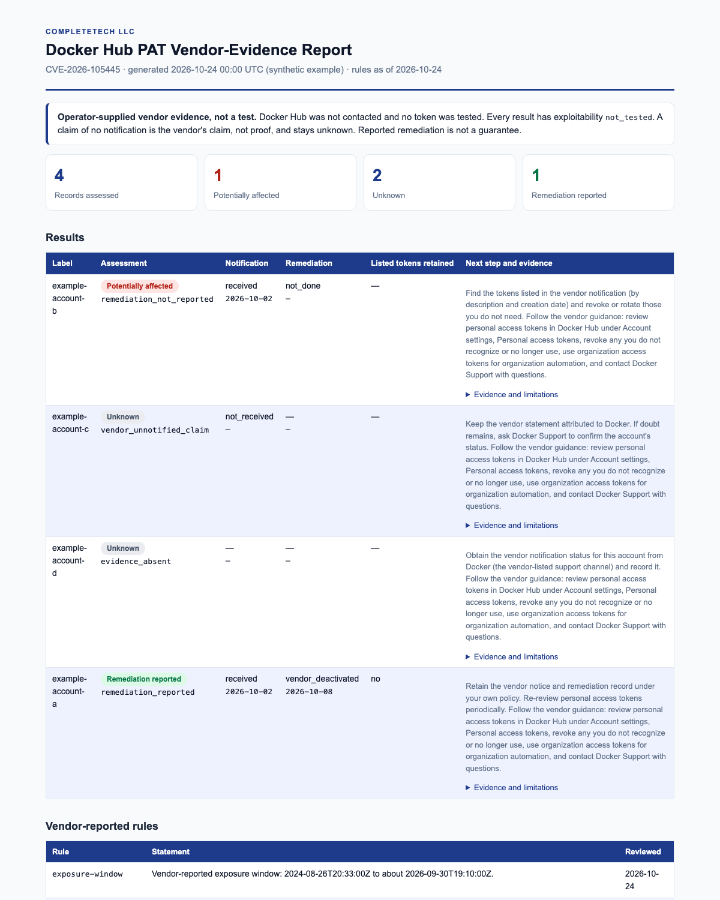

<p align="center">
  
</p>

<p align="center">
  
  
  <a href="LICENSING.md"></a>
</p>

<p align="center">
  <b>Docker Hub account-conversion PAT reassignment</b><br>
  CVE-2026-105445 · offline vendor-evidence recorder · not a scanner
</p>

---

`docker-hub-pat-check` is the dedicated repository for **CVE-2026-105445**, a historical, service-side Docker Hub exposure. Docker reports that account-to-organization conversion re-assigned personal access tokens (PATs) to the named new owner without rotating the token secret. The exposure ran from 2024-08-26 20:33 UTC until Docker's fix at about 2026-09-30 19:10 UTC.

There is **no client or Docker version rule**. Only Docker can say which accounts were exposed. This tool records evidence that an administrator already holds (whether Docker's notification arrived, when, and what remediation was done) and turns it into a consistent, reportable status. It is a single-file, standard-library Python 3.10+ program with **no network mode**: it never contacts Docker Hub, never tests a token, and never reads one.

## Quick start

```sh
python docker_hub_pat_check.py --notification received --notification-date 2026-10-02 \
  --remediation operator_revoked_or_rotated --remediation-date 2026-10-05 \
  --retained-listed-tokens no --label example-account --format json

python docker_hub_pat_check.py --inventory examples/evidence.example.json --format html --output report.html
python docker_hub_pat_check.py --evidence-csv examples/evidence.example.csv --format csv
python docker_hub_pat_check.py --help
```

Inputs can be one record on the command line, JSON files (`--inventory`), or CSV lists (`--evidence-csv`). Formats are `csv` (default), `json` and `html`. See [docs/REFERENCE.md](docs/REFERENCE.md) for every field, limit and exit code. Run the tests with `python -m unittest -v`.

## Report layout

<p align="center">
  <picture>
    <source media="(prefers-color-scheme: dark)" srcset="docs/images/report-dark.png">
    
  </picture>
</p>

<p align="center"><sub>Rendered from the synthetic <a href="examples/evidence.example.json">example evidence</a> (reserved <code>example-*</code> labels). Source: <a href="docs/example-report.html">docs/example-report.html</a>. It describes no real account.</sub></p>

## Result vocabulary

| Status | Meaning here |
| --- | --- |
| `potentially_affected` | The operator reports that Docker's notification was received, so the vendor considers a transferred PAT in scope, and remediation is not fully reported. Not confirmed exploitation. |
| `fixed_version_reported` | The notification was received and the operator reports remediation with a date and no knowingly retained listed token. There is no version comparison; this means "remediation reported", never a guarantee. |
| `unknown` | Evidence is missing, malformed, conflicting, out of the vendor timeline, or says only that no notification arrived. Never a clean result. |

`unsupported_runtime` does not apply: there is no runtime lifecycle. `docker_hub_pat_evidence_status` gives the reason (for example `vendor_unnotified_claim`, `conflicting_evidence`, `remediation_reported`), and `docker_hub_pat_exploitability` is always `not_tested`.

> [!IMPORTANT]
> **"Not notified" is Docker's claim, not proof.** Docker says accounts that received no email were not exposed. The tool records that attribution and still reports `unknown`. Docker also reports no evidence of exploitation; that is a vendor finding, not something this tool verifies. Registry logs show token use, not token existence, as the vendor itself notes.

## Vendor-reported facts encoded

Reviewed against the [vendor advisory](https://www.docker.com/blog/docker-hub-security-advisory-cve-2026-105445/) on 2026-10-24:

| Item | Vendor-reported value |
| --- | --- |
| Exposure start | 2024-08-26 20:33 UTC |
| Fix deployed | 2026-09-30, about 19:10 UTC (vendor approximation) |
| Notification emails | 2026-10-02 to users whose accounts received transferred PATs, and separately to their organization owners |
| Vendor deactivation of transferred PATs | 2026-10-08, except tokens whose owners asked to keep them |
| Vendor guidance | Review PATs under Account settings, Personal access tokens; revoke any you do not recognize or no longer use; use organization access tokens for organization automation; contact Docker Support |

The vendor post is the only source. The notification and deactivation details are vendor-reported and not independently verified here.

## What it does not do

- It does not probe Docker Hub, call any API, test tokens, or have a network option.
- It never accepts tokens. Any value that looks like a Docker token (`dckr_..._`) is rejected as an input error, without echoing it.
- It is not a generic scanner and does not infer exposure from versions, banners or account metadata.
- It does not store, log or upload anything. Reports contain only what you supplied. Keep real evidence and reports out of version control; the `reports/`, `private/` and `inventories/` paths are already ignored.

## Primary sources

1. [Docker Hub security advisory: personal access tokens transferred during account-to-organization conversions](https://www.docker.com/blog/docker-hub-security-advisory-cve-2026-105445/), reviewed 2026-10-24.

## One exploit, one repository

| Field | Scope |
| --- | --- |
| Exploit identifier | `CVE-2026-105445` |
| Aliases for this same exploit | None recorded |
| Research verification date | 2026-10-24 |
| Implementation state | `vendor_evidence_only`, implemented |

Aliases and affected products share this scope. Different vulnerabilities belong in independent repositories.

## Documentation

- [Reference](docs/REFERENCE.md) · [Implementation checklist](docs/IMPLEMENTATION.md) · [Advisory research record](advisory.json)
- [Contributing](CONTRIBUTING.md) · [Security policy](SECURITY.md) · [Licensing](LICENSING.md) · [Brand assets](BRAND_ASSETS.md)

## License

[AGPL-3.0](LICENSE), or a separate commercial agreement with CompleteTech LLC.
See [LICENSING.md](LICENSING.md) and the
[contribution terms](CONTRIBUTING.md#licensing-of-contributions).
Names and branding are governed by [BRAND_ASSETS.md](BRAND_ASSETS.md).

Copyright © 2026 CompleteTech LLC.
